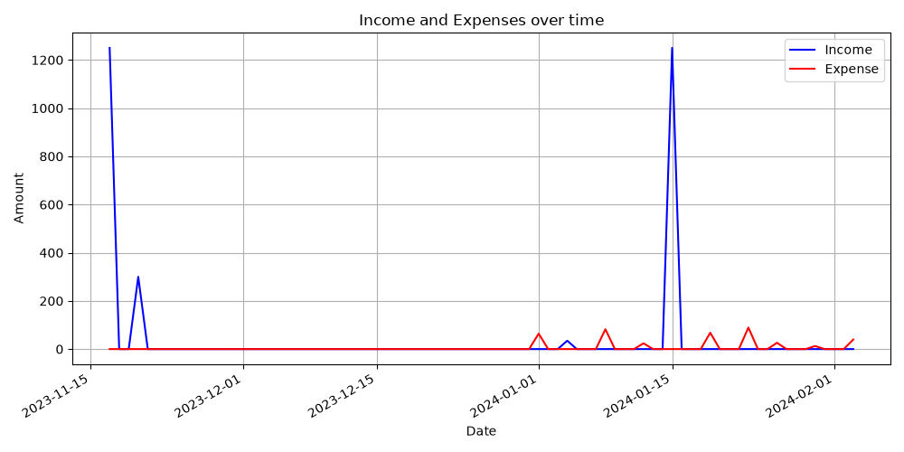

# Personal Finance Tracker

A command-line app for tracking income and expenses. Transactions are saved to a CSV file, and you can view a summary for any date range or plot your income and spending over time.



## Features

- Add transactions with a date, amount, category (Income / Expense) and description
- Input validation for dates (`dd-mm-yyyy`), amounts and categories
- View all transactions in a date range, with total income, total expenses and net savings
- Plot daily income vs. expenses with matplotlib

## Getting started

Requires Python 3.9+.

```bash
git clone https://github.com/DaniKabbani/personal-finance-tracker.git
cd personal-finance-tracker
python3 -m venv .venv
source .venv/bin/activate
pip install -r requirements.txt
python main.py
```

## Example

```
1. Add a new transaction
2. View transactions and summary within a date range
3. Exit
Enter your choice (1-3): 2
Enter the start date (dd-mm-yyyy): 01-01-2024
Enter the end date (dd-mm-yyyy): 31-01-2024

Summary:
Total income: $1284.76
Total expense: $366.25
Net savings: $918.51
```

`finance_data.csv` ships with sample data so you can try the summary and chart right away.

## Project structure

| File | Purpose |
|------|---------|
| `main.py` | Menu, CSV storage, summaries and plotting |
| `data_entry.py` | Validated user input (date, amount, category, description) |
| `finance_data.csv` | Transaction data (sample data included) |

## Built with

Python, pandas, matplotlib
